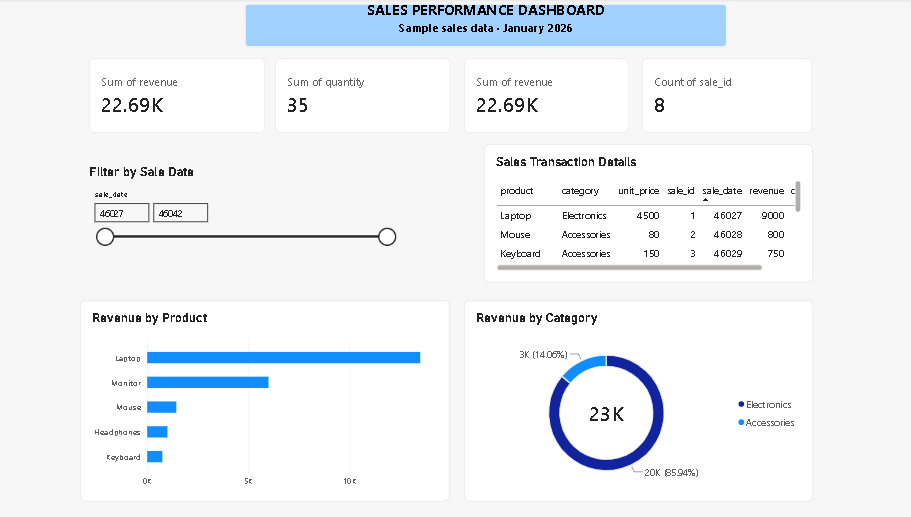

# Sales Performance Analysis Dashboard

An interactive sales performance dashboard developed using **Microsoft Power BI** to analyse sales revenue, product performance, and category contributions.

## Project Overview

This project explores sales transaction data and transforms it into meaningful business insights through data visualisation and interactive reporting.

## Tools & Technologies

- Microsoft Power BI
- Microsoft Excel
- Data Visualisation
- Business Intelligence

## Project Objectives

- Analyse total revenue generated.
- Measure the total quantity of products sold.
- Calculate average revenue per transaction.
- Identify the highest-performing products.
- Compare revenue across product categories.
- Explore sales performance using an interactive date filter.

## Key Performance Indicators (KPIs)

| Metric | Result |
|---|---:|
| Total Revenue | GH₵22,690 |
| Total Units Sold | 35 |
| Average Revenue per Transaction | GH₵2,836.25 |
| Total Transactions | 8 |

## Dashboard Preview

## Key Business Insights

- **Total Revenue:** GH₵22,690 was generated from eight transactions.
- **Top-Performing Product:** Laptops generated the highest revenue of GH₵13,500.
- **Second-Highest Product:** Monitors generated GH₵6,000.
- **Top-Performing Category:** Electronics contributed approximately 85.9% of total revenue.
- **Accessories:** Contributed approximately 14.1% of total revenue.

## Dashboard Features

- KPI cards for key sales metrics.
- Revenue by Product bar chart.
- Revenue by Category doughnut chart.
- Sales transaction details table.
- Interactive date slicer for filtering sales data.

## Project Files

| File | Description |
|---|---|
| `sales_analysis.xlsx` | Original sales dataset |
| `Sales_Performance_Dashboard.pbix` | Power BI dashboard file |
| `dashboard_screenshot.png` | Dashboard preview |

## Skills Demonstrated

- Data Analysis
- Microsoft Power BI
- Microsoft Excel
- Data Visualisation
- Dashboard Development
- KPI Reporting
- Business Intelligence
- Business Insights

## Conclusion

This project demonstrates the use of Power BI to transform structured sales data into an interactive dashboard that supports business reporting and decision-making.

**Project Status:** Completed

**Author:** Joel Adjei Klufio
